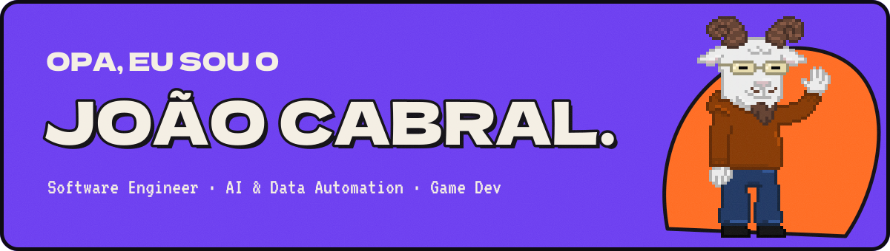
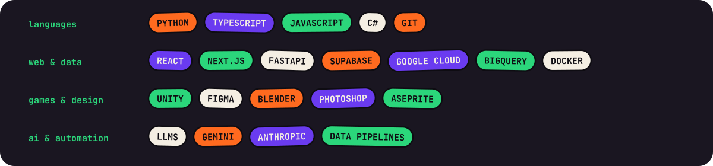

  

<h1 align="center">Sup, I'm Cabral! ⚡</h1>

I'm a software engineer and independent game dev from Santa Catarina, Brazil, and I love building digital products from scratch. I look beyond the "just works" mantra: I aim to build something stable, make it look good, and get it in front of people to use or play.

  <a href="https://thxcabra.github.io/portfolio/"><b>Portfolio</b></a> &nbsp;·&nbsp;
  <a href="https://www.linkedin.com/in/joao-cabral-machado/"><b>LinkedIn</b></a> &nbsp;·&nbsp;
  <a href="mailto:joaovcabralm@hotmail.com"><b>joaovcabralm@hotmail.com</b></a>

---

### 🎮 My portfolio is also a game

  

A Pokémon FireRed Pokémon Center inside a Game Boy Advance, rebuilt in the browser: the projects are Pokémon in the PC's Box, the Nurse heals your team, the trainer card is my CV. Numbers taken from the game's decompilation, music synthesized from the game's own data. <a href="https://thxcabra.github.io/portfolio/">Play it</a>.

---

### 🚀 What I do

* **🎮 Software engineering & game dev:** C#, Python and TypeScript to build systems, mechanics and products that are ready to ship.
* **🤖 AI & data automation:** LLM-powered tools, data pipelines and API integrations that cut out manual work.
* **✨ Digital design:** UI/UX, branding and 2D/3D assets that make sense and look professional.
* **📈 Product strategy:** a marketing background in Web3 to read an audience and position a product for launch.

---

### 📌 Featured projects

| Project | What it is | Stack |
|---|---|---|
| [**Pokémon Center portfolio**](https://thxcabra.github.io/portfolio/) | This portfolio as a game: a Pokémon FireRed Pokémon Center inside a Game Boy Advance, rebuilt in the browser with numbers taken from the game's decompilation and music synthesized from the game's own data, plus a landing page in its own collage style for a quick read ([code](https://github.com/thxcabra/portfolio)). | JavaScript · HTML/CSS · WebGL · Python asset pipeline |
| [**PitchIQ**](https://github.com/thxcabra/PitchIQ) | Football analytics for the 2025-26 European season: player, team and competition profiles, head-to-head comparison and a bilingual "Ask PitchIQ" chat where the LLM only reads the question and the numbers come from deterministic code. | Python · FastAPI · React · TypeScript · Gemini · Docker |
| [**Magnifyer Glass**](https://github.com/thxcabra/Magnifyer-Glass) | An NBA site: live scores, box scores, play-by-play, standings, playoff bracket, team and player pages and a play-style "archetype" classifier. | Next.js · React · FastAPI · Supabase · scikit-learn |
| [**Replai**](https://github.com/thxcabra/replai) | A Chrome extension that finds the X and LinkedIn conversations worth replying to and drafts replies in the brand's own voice. | TypeScript · Preact · Supabase · Gemini · Anthropic |
| [**CallSync**](https://github.com/thxcabra/CallSync) | Upload a sales call (audio or transcript) and get a structured analysis (summary, sentiment, tasks, feedback) synced to Notion. | TypeScript · Express · React · Gemini · Supabase · Notion API |
| [**Furioso-Bot**](https://github.com/thxcabra/Furioso-Bot) | A Telegram bot that answers like a FURIA Esports fan, with a classify → search → reply LLM pipeline over trusted sources. | Python · python-telegram-bot · OpenRouter · Tavily |
| [**MOIC Digital website**](https://www.moicdigital.com) | The agency's website: content-driven pages and blog, SEO, lead forms straight into the CRM, deployed on the edge with a staging → production review flow. | Cloudflare Workers · CRM integration · SEO |

---

### 🛠 Tech stack

  

---

  <i>Always open to talking with teams and people who are making interesting things. Feel free to reach out.</i>

The art on this page is drawn from code (<code>tools/art.py</code>): the shapes and the low poly piece are SVG, the text is the Unbounded and JetBrains Mono fonts turned into paths, and the pixel Pikachu and the GBA recording come from the portfolio itself.
